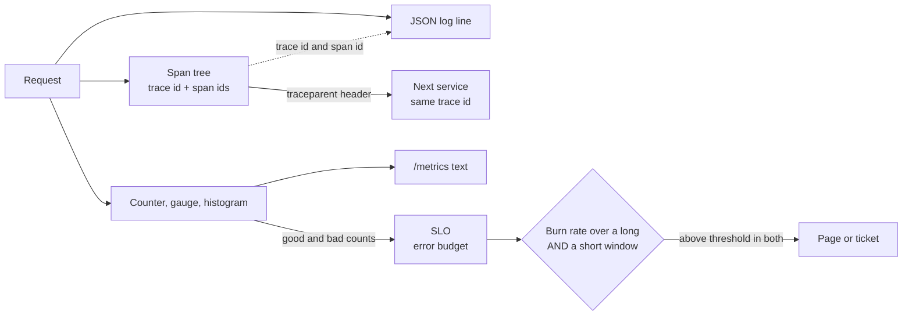

# observability-kit

The three signals used to understand a running service, plus the alerting that sits on top of them, written from scratch so the mechanics are readable: metrics in the Prometheus format, distributed traces with W3C trace context, structured logs tied to traces, and SLO burn-rate alerts.

No dependencies. Python 3.10+.

## How the pieces connect



A dashboard shows the latency or error rate moving. A trace shows which step of which request was slow. The trace id on every log line finds what that request wrote. The SLO decides whether any of it is worth waking someone for.

## What is in it

| Piece | What it does | Tested by |
|---|---|---|
| Counter, Gauge, Histogram | Labelled series, thread-safe. A wrong label set is an error, not a silent new series | `test_counter_counts_per_label_set_and_cannot_go_down`, `test_counter_is_thread_safe` (8 threads, 40,000 increments) |
| Prometheus exposition | `# HELP`, `# TYPE`, cumulative `le` buckets, `_sum`, `_count`, label escaping | `test_prometheus_text_format_exactly` compares the full output byte for byte |
| `histogram_quantile` | Percentile estimate by linear interpolation inside the bucket, as Prometheus does | on 5,000 log-normal samples the estimate always lands in the same bucket as the exact value |
| Spans | Parent and child linked through context variables; an exception marks the span failed and still propagates | `test_nested_spans_...`, `test_exception_marks_the_span_failed_...` |
| Concurrency | Five interleaved asyncio requests each keep their own span stack | `test_concurrent_tasks_do_not_see_each_others_spans` |
| W3C trace context | `traceparent` written on outgoing calls and read on incoming ones; malformed headers start a new trace | round trip across two tracers; seven malformed headers rejected |
| Sampling | Decided once at the root and inherited | at a 25% rate no trace is ever half-recorded |
| JSON logs | One object per line, trace and span id attached, sensitive field names redacted | `test_log_lines_are_json_with_trace_ids_and_redaction` |
| SLO and error budget | Burn rate = error rate / allowed error rate; budget remaining over the period | `test_burn_rate_is_error_rate_over_budget`, `test_budget_remaining_goes_negative_when_overspent` |
| Multi-window alerts | Fires only when both the long and the short window exceed the threshold | a short blip does not page; the page stops six minutes after a fix while the hourly rate is still high |

23 tests. CI runs them on Python 3.10 and 3.12, then the demo.

### The alert thresholds

The defaults follow the multi-window, multi-burn-rate scheme in Google's *Site Reliability Workbook* (chapter 5, "Alerting on SLOs") for a 30-day objective. A test recomputes the budget share from each threshold.

| Alert | Burn rate | Long window | Short window | Budget spent before firing | Action |
|---|---|---|---|---|---|
| fast-burn | 14.4x | 1 hour | 5 minutes | 2% | page |
| slow-burn | 6x | 6 hours | 30 minutes | 5% | page |
| budget-leak | 1x | 3 days | 6 hours | 10% | ticket |

## Demo

`python -m obskit` runs a **simulated** checkout service through an incident. It uses a fake clock and a seeded random generator: there is no network and no real service, and latencies are drawn from a distribution, not measured. The instrumentation code it drives is the real library. Actual output:

```
Simulated: day 30 of a month, 8 hours of traffic at 60 requests a minute, against a 99.9% objective.
From 3h00 to 4h00 a bad deploy makes 5% of payments time out.

3h19  FIRING    fast-burn   (page)  burn rate 14.7x over 1h, 36.7x over 5m
3h42  FIRING    slow-burn   (page)  burn rate 6.1x over 6h, 52.8x over 30m
4h03  resolved  fast-burn
4h27  resolved  slow-burn

After 8 hours: 28800 requests, 176 failed, 30-day error budget remaining 72%
Latency p99: 99 ms estimated from histogram buckets, 73 ms exact. The gap is the bucket width (50 to 100 ms).

One failed request, as a trace (the payments span ran in the 'other service', joined by the traceparent header):
checkout: POST /orders  64 ms  [error]
  db: SELECT cart  8 ms
  http: call payments  56 ms  [error]
    payments: POST /charge  56 ms  [error]

Its log line, found by trace id:
{"ts": 2516400.064, "level": "error", "service": "checkout", "msg": "order failed", "trace_id": "c277405b33a91a29395577e0a887fa3d", "span_id": "c4e046b5ac01e1ba", "error": "card processor timed out"}

A successful request's log line (note the redacted field):
{"ts": 2505600.052, "level": "info", "service": "checkout", "msg": "order placed", "trace_id": "db5b5fab8f4d3e27dda1494c73cf256d", "span_id": "c7fde805ec99108d", "password": "[redacted]"}

/metrics excerpt:
# HELP http_request_duration_seconds Request latency
# TYPE http_request_duration_seconds histogram
http_request_duration_seconds_bucket{route="/orders",le="0.1"} 28800
http_request_duration_seconds_bucket{route="/orders",le="+Inf"} 28800
http_request_duration_seconds_sum{route="/orders"} 1478.596937571
http_request_duration_seconds_count{route="/orders"} 28800
# HELP http_requests_in_flight Requests being handled now
# TYPE http_requests_in_flight gauge
http_requests_in_flight 0
# HELP http_requests_total Requests handled
# TYPE http_requests_total counter
http_requests_total{route="/orders",status="200"} 28624
http_requests_total{route="/orders",status="503"} 176
```

Reading it: the page arrives 19 minutes into the incident, once 2% of the month's budget is gone. After the fix at 4h00 the fast alert clears in 3 minutes because its 5-minute window is clean, even though the 1-hour error rate is still high. The p99 line shows the cost of histograms: the estimate cannot be more precise than the bucket it falls in.

## Use

```python
from obskit import Registry, Tracer, JsonLogger, SLO, inject, extract

registry, tracer, log = Registry(), Tracer(), JsonLogger("api")
requests = registry.counter("http_requests_total", "Requests", ("route", "status"))
latency = registry.histogram("http_request_duration_seconds", "Latency", ("route",))

def handle(request):
    with tracer.span("GET /items", parent=extract(request.headers)) as span:
        log.info("fetching items")                       # carries trace_id and span_id
        downstream_headers = inject({})                  # pass to the next service
        ...
    requests.inc(route="/items", status="200")
    latency.observe(span.duration, route="/items")

registry.render()                                        # body for GET /metrics
```

## Layout

| File | Contents |
|---|---|
| `obskit/metrics.py` | Metric types, registry, text format, quantile estimation |
| `obskit/tracing.py` | Spans, tracer, context propagation, `traceparent` |
| `obskit/logs.py` | JSON logger with trace correlation and redaction |
| `obskit/slo.py` | Error budget, burn rate, multi-window alerts |
| `obskit/__main__.py` | The simulated incident |

## Limits

- This is a teaching implementation. Production services should use the OpenTelemetry SDK and a Prometheus client library; this shows what those do underneath.
- Finished spans are kept in memory in a list. There is no exporter to Jaeger, Tempo or an OTLP collector, and no batching.
- There is no HTTP server for `/metrics`; `Registry.render()` returns the text for a web framework to serve.
- Only `traceparent` is handled. `tracestate` and baggage are not.
- The SLO keeps per-minute counts in process memory, so it resets on restart. In practice burn rates are computed by the metrics backend from the counters.
- Log redaction matches field names only. A secret inside a message string is not caught.
- The demo's numbers come from a simulation and say nothing about real-world performance.
